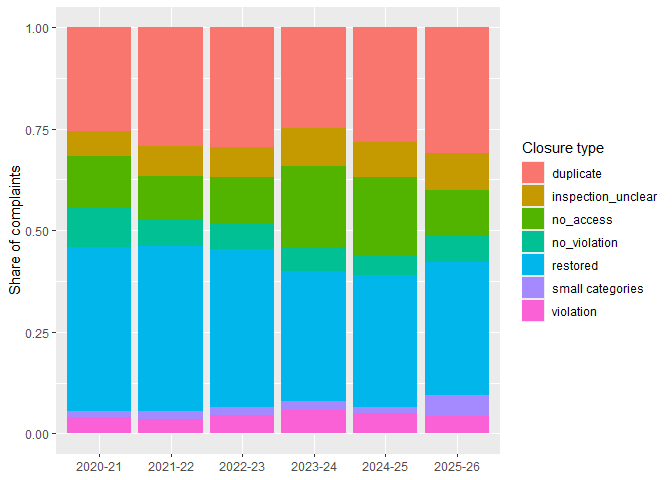

RQ3 Cleaning: Closure Time and Closure Type
================

This file prepares the complaint-level data for RQ3: are heat complaints
handled differently in lower-income neighborhoods? It reads the six raw
season files made by `download_311.Rmd`, computes how long each
complaint took to close, checks data quality, and sorts the free-text
`resolution_description` into closure types. Income groups (ACS) and
building size (PLUTO) are added later, in the RQ3 analysis file.

``` r
library(tidyverse)
library(lubridate)

knitr::opts_chunk$set(message = FALSE, warning = FALSE)

raw_dir = "data/raw"
processed_dir = "data/processed"

dir.create(processed_dir, recursive = TRUE, showWarnings = FALSE)
```

## Read the raw data

All columns are read as character, as in the download step.

``` r
heat_raw =
  list.files(raw_dir, pattern = "^311_heat_.*\\.csv\\.gz$", full.names = TRUE) |>
  map(\(f) read_csv(f, col_types = cols(.default = col_character()))) |>
  bind_rows()

stopifnot(
  nrow(heat_raw) == 1484133,
  n_distinct(heat_raw$unique_key) == nrow(heat_raw))

heat_raw |>
  count(season) |>
  knitr::kable()
```

| season  |      n |
|:--------|-------:|
| 2020-21 | 178420 |
| 2021-22 | 222676 |
| 2022-23 | 225132 |
| 2023-24 | 235654 |
| 2024-25 | 280427 |
| 2025-26 | 341824 |

## Dates, closure time, and text clean-up

`descriptor` and `descriptor_2` are converted to upper case because
2023-24 contains mixed-case values (for example `Apartment Only`). Two
`HEAT ON IN SUMMER` records and one `WATER SUPPLY` record are dropped.

``` r
heat_df =
  heat_raw |>
  mutate(
    created = ymd_hms(created_date),
    closed  = ymd_hms(closed_date),
    hours   = as.numeric(difftime(closed, created, units = "hours")),
    days    = hours / 24,
    month   = month(created),
    descriptor   = str_to_upper(descriptor),
    descriptor_2 = str_to_upper(descriptor_2),
    borough      = str_to_upper(borough),
    problem = case_when(
      descriptor_2 == "NO HEAT"                  ~ "heat",
      descriptor_2 == "NO HOT WATER"             ~ "hot water",
      descriptor_2 == "NO HEAT AND NO HOT WATER" ~ "heat and hot water")) |>
  filter(
    descriptor_2 != "HEAT ON IN SUMMER",
    descriptor != "WATER SUPPLY")

# Every created date should parse; closed is missing only where closed_date is missing
heat_df |>
  summarize(
    n_rows = n(),
    created_missing = sum(is.na(created)),
    closed_date_missing = sum(is.na(closed_date)),
    closed_missing = sum(is.na(closed))) |>
  knitr::kable()
```

|  n_rows | created_missing | closed_date_missing | closed_missing |
|--------:|----------------:|--------------------:|---------------:|
| 1484130 |               0 |               16247 |          16247 |

## Data quality flags

Complaints that are still open have no closure time. Negative closure
times are errors and are removed in the analysis. Zero and very long
closure times are kept but flagged.

``` r
heat_df =
  heat_df |>
  mutate(
    flag = case_when(
      is.na(closed) ~ "open",
      hours < 0     ~ "negative",
      hours == 0    ~ "zero",
      days > 365    ~ "over 1 year",
      TRUE          ~ "ok"))

heat_df |>
  count(season, flag) |>
  pivot_wider(names_from = flag, values_from = n, values_fill = 0) |>
  knitr::kable()
```

| season  |     ok |  open | over 1 year | zero | negative |
|:--------|-------:|------:|------------:|-----:|---------:|
| 2020-21 | 178231 |   147 |          34 |    6 |        0 |
| 2021-22 | 222408 |   228 |          34 |    6 |        0 |
| 2022-23 | 224957 |   160 |           4 |   11 |        0 |
| 2023-24 | 235134 |   322 |          12 |   23 |      162 |
| 2024-25 | 276159 |  4241 |           3 |   24 |        0 |
| 2025-26 | 330653 | 11149 |           0 |   22 |        0 |

Closure time among closed complaints:

``` r
heat_df |>
  filter(flag %in% c("ok", "zero", "over 1 year")) |>
  group_by(season) |>
  summarize(
    n = n(),
    median_days   = median(days),
    p90_days      = quantile(days, 0.9),
    pct_within_3d = mean(days <= 3)) |>
  knitr::kable(digits = 2)
```

| season  |      n | median_days | p90_days | pct_within_3d |
|:--------|-------:|------------:|---------:|--------------:|
| 2020-21 | 178271 |        2.15 |     4.71 |          0.69 |
| 2021-22 | 222448 |        1.94 |     4.89 |          0.71 |
| 2022-23 | 224972 |        1.85 |     4.26 |          0.76 |
| 2023-24 | 235169 |        1.44 |     3.19 |          0.87 |
| 2024-25 | 276186 |        1.75 |     3.46 |          0.82 |
| 2025-26 | 330675 |        1.76 |     3.56 |          0.82 |

## Closure types

`resolution_description` contains a small set of fixed HPD messages. The
rules below sort them into closure types. Order matters: “No violations
were issued” also contains “violations were issued”, so the no-violation
rule must come before the violation rule.

``` r
heat_df =
  heat_df |>
  mutate(
    res_text = str_to_lower(resolution_description),
    res_cat = case_when(
      is.na(res_text) ~ "missing",
      str_detect(res_text, "duplicate") ~ "duplicate",
      str_detect(res_text, "heat was not required") ~ "heat_not_required",
      str_detect(res_text, "no violations were issued|did not violate") ~ "no_violation",
      str_detect(res_text, "violations were issued|violation was issued|violations were previously issued") ~ "violation",
      str_detect(res_text, "not able to gain access|unable to complete the inspection") ~ "no_access",
      str_detect(res_text, "restored|corrected|addressed") ~ "restored",
      str_detect(res_text, "conducted or attempted to conduct") ~ "inspection_unclear",
      str_detect(res_text, "still open") ~ "still_open",
      str_detect(res_text, "administratively") ~ "admin_closed",
      TRUE ~ "other"),
    res_group =
      if_else(
        res_cat %in% c("restored", "duplicate", "no_access", "inspection_unclear",
                       "no_violation", "violation"),
        res_cat, "small categories"))

# Lookup table: every distinct message and its closure type (for the report appendix)
res_map =
  heat_df |>
  count(res_cat, resolution_description, sort = TRUE)

stopifnot(!any(res_map$res_cat == "other"))

write_csv(res_map, file.path(processed_dir, "rq3_resolution_map.csv"))

heat_df |>
  group_by(res_cat) |>
  summarize(
    n = n(),
    median_days = median(days, na.rm = TRUE)) |>
  mutate(pct = n / sum(n)) |>
  arrange(desc(n)) |>
  knitr::kable(digits = 3)
```

| res_cat            |      n | median_days |   pct |
|:-------------------|-------:|------------:|------:|
| restored           | 528756 |       1.767 | 0.356 |
| duplicate          | 420544 |       1.824 | 0.283 |
| no_access          | 211428 |       2.235 | 0.142 |
| inspection_unclear | 121726 |       0.318 | 0.082 |
| no_violation       |  95368 |       2.302 | 0.064 |
| violation          |  67496 |       2.135 | 0.045 |
| still_open         |  19394 |       3.220 | 0.013 |
| heat_not_required  |  17548 |       1.874 | 0.012 |
| missing            |   1250 |       0.679 | 0.001 |
| admin_closed       |    620 |       0.087 | 0.000 |

Closure types by season:

``` r
heat_df |>
  count(season, res_group) |>
  group_by(season) |>
  mutate(pct = n / sum(n)) |>
  select(-n) |>
  pivot_wider(names_from = res_group, values_from = pct) |>
  knitr::kable(digits = 3)
```

| season | duplicate | inspection_unclear | no_access | no_violation | restored | small categories | violation |
|:---|---:|---:|---:|---:|---:|---:|---:|
| 2020-21 | 0.255 | 0.062 | 0.129 | 0.095 | 0.405 | 0.015 | 0.040 |
| 2021-22 | 0.293 | 0.074 | 0.106 | 0.065 | 0.407 | 0.018 | 0.036 |
| 2022-23 | 0.294 | 0.075 | 0.114 | 0.062 | 0.390 | 0.019 | 0.046 |
| 2023-24 | 0.249 | 0.094 | 0.199 | 0.058 | 0.320 | 0.024 | 0.057 |
| 2024-25 | 0.282 | 0.087 | 0.192 | 0.049 | 0.325 | 0.016 | 0.049 |
| 2025-26 | 0.310 | 0.091 | 0.113 | 0.065 | 0.326 | 0.052 | 0.043 |

``` r
heat_df |>
  ggplot(aes(x = season, fill = res_group)) +
  geom_bar(position = "fill") +
  labs(x = NULL, y = "Share of complaints", fill = "Closure type")
```

<!-- -->

Closure types by complaint scope. Building-wide complaints are more
often closed as duplicates, so scope (and building size) must be
controlled for when comparing income groups.

``` r
heat_df |>
  count(descriptor, res_group) |>
  group_by(descriptor) |>
  mutate(pct = n / sum(n)) |>
  select(-n) |>
  pivot_wider(names_from = res_group, values_from = pct) |>
  knitr::kable(digits = 3)
```

| descriptor | duplicate | inspection_unclear | no_access | no_violation | restored | small categories | violation |
|:---|---:|---:|---:|---:|---:|---:|---:|
| APARTMENT ONLY | 0.224 | 0.065 | 0.201 | 0.11 | 0.302 | 0.026 | 0.072 |
| ENTIRE BUILDING | 0.314 | 0.091 | 0.112 | 0.04 | 0.385 | 0.026 | 0.031 |

## First look by borough

Income groups are added in the analysis step. As a first look, closed
complaints are compared across boroughs.

``` r
heat_df |>
  filter(
    flag %in% c("ok", "zero", "over 1 year"),
    borough %in% c("BRONX", "BROOKLYN", "MANHATTAN", "QUEENS", "STATEN ISLAND")) |>
  group_by(borough) |>
  summarize(
    n = n(),
    median_days   = median(days),
    pct_duplicate = mean(res_cat == "duplicate"),
    pct_no_access = mean(res_cat == "no_access"),
    pct_violation = mean(res_cat == "violation")) |>
  knitr::kable(digits = 3)
```

| borough       |      n | median_days | pct_duplicate | pct_no_access | pct_violation |
|:--------------|-------:|------------:|--------------:|--------------:|--------------:|
| BRONX         | 521349 |       1.529 |         0.247 |         0.102 |         0.043 |
| BROOKLYN      | 394235 |       1.914 |         0.298 |         0.168 |         0.053 |
| MANHATTAN     | 337454 |       1.937 |         0.325 |         0.160 |         0.041 |
| QUEENS        | 198386 |       1.954 |         0.304 |         0.174 |         0.043 |
| STATEN ISLAND |  16291 |       1.890 |         0.240 |         0.220 |         0.086 |

## Save the complaint-level dataset

All rows are kept, with `flag`, so that open complaints can still be
compared across income groups. The analysis filters on `flag`.

``` r
rq3_complaints =
  heat_df |>
  select(
    unique_key, season, created, closed, hours, days, month, status, flag,
    res_cat, res_group, descriptor, problem, borough, incident_zip, bbl,
    open_data_channel_type)

write_rds(rq3_complaints, file.path(processed_dir, "rq3_complaints.rds"), compress = "gz")

nrow(rq3_complaints)
```

    ## [1] 1484130

## Next steps

1.  Add ZCTA income quintiles from ACS (shared with RQ2), joined by
    `incident_zip`.
2.  Add residential units from PLUTO, joined by `bbl`.
3.  Compare closure time and closure types across income quintiles, then
    fit `lm()` and `glm(family = binomial())` models that control for
    season, month, scope, problem type, borough, channel, and building
    size.
