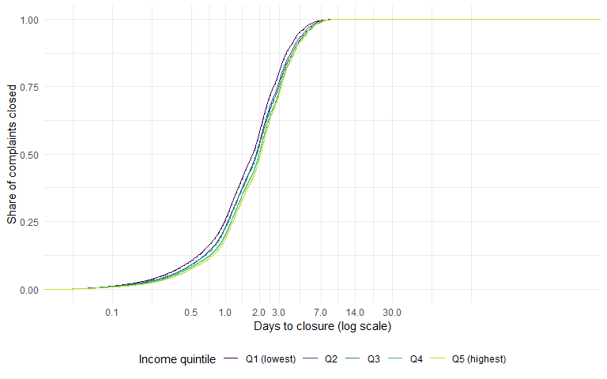
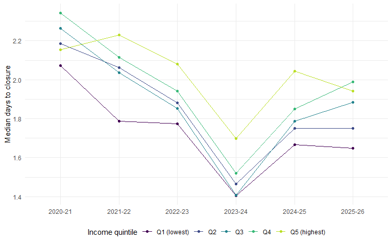
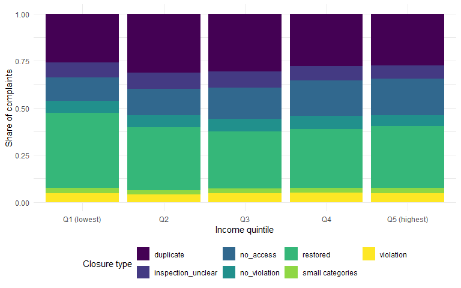
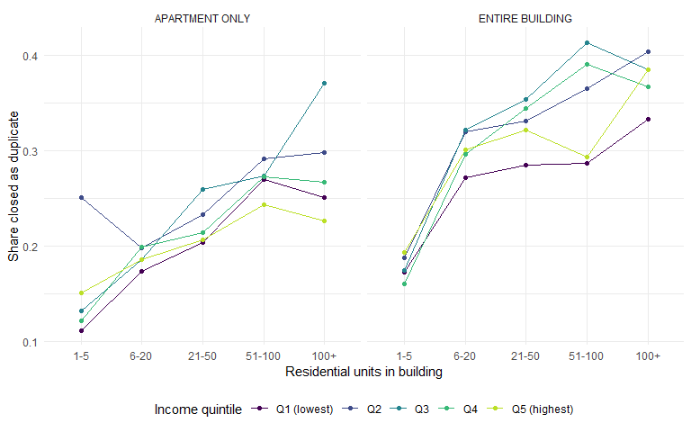

RQ3: Are Heat Complaints Handled Differently in Lower-Income
Neighborhoods?
================

This file links each heat complaint to the income level of its
neighborhood (ACS, by ZCTA) and to the size and age of its building
(PLUTO, by BBL), then compares how complaints were closed across income
groups. It uses the outputs of `clean_rq3.Rmd`, `download_acs.Rmd`, and
`download_pluto.Rmd`, so those three files must be knit first.

Part 1 (this version) builds the analysis dataset and describes the
differences. Part 2 (regression models) will be added after we look at
these results.

``` r
library(tidyverse)

knitr::opts_chunk$set(
  message = FALSE, warning = FALSE,
  fig.width = 8, fig.height = 5, out.width = "90%")

theme_set(theme_minimal() + theme(legend.position = "bottom"))

processed_dir = "data/processed"
```

## Read the three inputs

``` r
rq3_complaints = read_rds(file.path(processed_dir, "rq3_complaints.rds"))

acs_zcta =
  read_csv(file.path(processed_dir, "acs_zcta.csv"), col_types = cols(zcta = col_character()))

pluto = read_rds(file.path(processed_dir, "pluto_bbl.rds"))

c(complaints = nrow(rq3_complaints), zcta = nrow(acs_zcta), tax_lots = nrow(pluto))
```

    ## complaints       zcta   tax_lots 
    ##    1484130        211     858312

## Income groups

ZCTAs with fewer than 100 renter households or no median income are
dropped, because their estimates are unstable. The remaining ZCTAs are
split into five equal-sized groups by median household income (Q1 =
lowest). A poverty-rate grouping is kept for a sensitivity check.

``` r
income_groups =
  acs_zcta |>
  filter(renter_hh >= 100, !is.na(median_income)) |>
  mutate(
    income_q = ntile(median_income, 5),
    income_q = factor(income_q, levels = 1:5,
                      labels = c("Q1 (lowest)", "Q2", "Q3", "Q4", "Q5 (highest)")),
    poverty_grp = cut(poverty_rate, c(-Inf, 0.10, 0.20, 0.30, Inf),
                      labels = c("<10%", "10-20%", "20-30%", "30%+"))) |>
  select(zcta, income_q, poverty_grp, median_income, poverty_rate, renter_hh)

income_groups |>
  group_by(income_q) |>
  summarize(
    n_zcta = n(),
    min_income = min(median_income),
    max_income = max(median_income),
    median_poverty_rate = median(poverty_rate, na.rm = TRUE)) |>
  knitr::kable(digits = 2, format.args = list(big.mark = ","))
```

| income_q     | n_zcta | min_income | max_income | median_poverty_rate |
|:-------------|-------:|-----------:|-----------:|--------------------:|
| Q1 (lowest)  |     36 |     24,086 |     62,411 |                0.29 |
| Q2           |     36 |     62,712 |     81,188 |                0.17 |
| Q3           |     36 |     81,244 |     96,617 |                0.12 |
| Q4           |     35 |     96,866 |    125,734 |                0.10 |
| Q5 (highest) |     35 |    125,850 |    250,000 |                0.09 |

## Join income and building data to complaints

Each join must keep the number of rows unchanged; `pluto` and
`income_groups` both have one row per key.

``` r
stopifnot(
  n_distinct(income_groups$zcta) == nrow(income_groups),
  n_distinct(pluto$bbl) == nrow(pluto))

n_before = nrow(rq3_complaints)

rq3_df =
  rq3_complaints |>
  mutate(zip = str_sub(incident_zip, 1, 5)) |>
  left_join(income_groups, by = c("zip" = "zcta")) |>
  left_join(select(pluto, bbl, unitsres, yearbuilt), by = "bbl") |>
  mutate(
    closed_3d = as.integer(days <= 3),
    size = cut(unitsres, c(0, 5, 20, 50, 100, Inf),
               labels = c("1-5", "6-20", "21-50", "51-100", "100+")),
    season = factor(season),
    month = factor(month, levels = c(10, 11, 12, 1, 2, 3, 4, 5)))

stopifnot(nrow(rq3_df) == n_before)
```

How many complaints could be matched?

``` r
rq3_df |>
  summarize(
    n = n(),
    pct_with_income = mean(!is.na(income_q)),
    pct_with_units  = mean(!is.na(size))) |>
  knitr::kable(digits = 4, format.args = list(big.mark = ","))
```

|         n | pct_with_income | pct_with_units |
|----------:|----------------:|---------------:|
| 1,484,130 |          0.9998 |         0.9809 |

``` r
rq3_df |>
  group_by(borough) |>
  summarize(
    n = n(),
    pct_with_income = mean(!is.na(income_q)),
    pct_with_units  = mean(!is.na(size))) |>
  knitr::kable(digits = 4, format.args = list(big.mark = ","))
```

| borough       |       n | pct_with_income | pct_with_units |
|:--------------|--------:|----------------:|---------------:|
| BRONX         | 528,699 |          1.0000 |         0.9874 |
| BROOKLYN      | 397,579 |          0.9999 |         0.9782 |
| MANHATTAN     | 341,591 |          0.9998 |         0.9759 |
| QUEENS        | 199,841 |          0.9991 |         0.9785 |
| STATEN ISLAND |  16,414 |          1.0000 |         0.9715 |
| UNSPECIFIED   |       3 |          0.0000 |         0.0000 |
| NA            |       3 |          0.0000 |         0.0000 |

The analysis below uses complaints with an income group. Closure time
uses closed complaints only (flags `ok`, `zero`, and `over 1 year`);
open complaints are compared separately.

``` r
rq3_income = rq3_df |> filter(!is.na(income_q))

rq3_closed = rq3_income |> filter(flag %in% c("ok", "zero", "over 1 year"))

c(with_income = nrow(rq3_income), closed = nrow(rq3_closed))
```

    ## with_income      closed 
    ##     1483837     1467431

## Where complaints come from

Complaints are not spread evenly across income groups, and buildings
differ in size across groups. Both matter for the comparisons below.

``` r
rq3_income |>
  group_by(income_q) |>
  summarize(
    n_complaints = n(),
    pct_entire_building = mean(descriptor == "ENTIRE BUILDING"),
    median_units = median(unitsres, na.rm = TRUE),
    median_year_built = median(yearbuilt, na.rm = TRUE)) |>
  mutate(pct_of_complaints = n_complaints / sum(n_complaints)) |>
  knitr::kable(digits = 3, format.args = list(big.mark = ","))
```

| income_q | n_complaints | pct_entire_building | median_units | median_year_built | pct_of_complaints |
|:---|---:|---:|---:|---:|---:|
| Q1 (lowest) | 675,949 | 0.647 | 47 | 1,927 | 0.456 |
| Q2 | 404,097 | 0.675 | 48 | 1,930 | 0.272 |
| Q3 | 200,131 | 0.642 | 36 | 1,931 | 0.135 |
| Q4 | 101,997 | 0.641 | 32 | 1,930 | 0.069 |
| Q5 (highest) | 101,663 | 0.691 | 20 | 1,920 | 0.069 |

## Closure time by income group

``` r
rq3_closed |>
  group_by(income_q) |>
  summarize(
    n = n(),
    median_days = median(days),
    p90_days = quantile(days, 0.9),
    pct_within_3d = mean(closed_3d)) |>
  knitr::kable(digits = 3, format.args = list(big.mark = ","))
```

| income_q     |       n | median_days | p90_days | pct_within_3d |
|:-------------|--------:|------------:|---------:|--------------:|
| Q1 (lowest)  | 667,191 |       1.702 |    3.734 |         0.813 |
| Q2           | 400,359 |       1.829 |    4.034 |         0.779 |
| Q3           | 198,277 |       1.852 |    4.160 |         0.766 |
| Q4           | 101,131 |       1.939 |    4.278 |         0.745 |
| Q5 (highest) | 100,473 |       2.000 |    4.277 |         0.737 |

If complaints from lower-income neighborhoods took longer to close, the
Q1 curve would lie to the right of the Q5 curve.

``` r
rq3_closed |>
  ggplot(aes(x = days + 1 / 24, color = income_q)) +
  stat_ecdf() +
  scale_x_log10(breaks = c(0.1, 0.5, 1, 2, 3, 7, 14, 30)) +
  scale_color_viridis_d(end = 0.9) +
  labs(
    x = "Days to closure (log scale)",
    y = "Share of complaints closed",
    color = "Income quintile")
```



Did the gap change across seasons, especially in the 2025-26 spike?

``` r
rq3_closed |>
  group_by(season, income_q) |>
  summarize(median_days = median(days), .groups = "drop") |>
  ggplot(aes(x = season, y = median_days, color = income_q, group = income_q)) +
  geom_line() +
  geom_point() +
  scale_color_viridis_d(end = 0.9) +
  labs(x = NULL, y = "Median days to closure", color = "Income quintile")
```



## Closure type by income group

``` r
rq3_income |>
  group_by(income_q) |>
  summarize(
    n = n(),
    duplicate = mean(res_cat == "duplicate"),
    no_access = mean(res_cat == "no_access"),
    restored = mean(res_cat == "restored"),
    inspection_unclear = mean(res_cat == "inspection_unclear"),
    no_violation = mean(res_cat == "no_violation"),
    violation = mean(res_cat == "violation")) |>
  knitr::kable(digits = 3, format.args = list(big.mark = ","))
```

| income_q | n | duplicate | no_access | restored | inspection_unclear | no_violation | violation |
|:---|---:|---:|---:|---:|---:|---:|---:|
| Q1 (lowest) | 675,949 | 0.259 | 0.123 | 0.397 | 0.081 | 0.065 | 0.048 |
| Q2 | 404,097 | 0.315 | 0.139 | 0.333 | 0.086 | 0.063 | 0.040 |
| Q3 | 200,131 | 0.306 | 0.166 | 0.302 | 0.088 | 0.066 | 0.047 |
| Q4 | 101,997 | 0.280 | 0.188 | 0.314 | 0.074 | 0.070 | 0.050 |
| Q5 (highest) | 101,663 | 0.276 | 0.194 | 0.325 | 0.071 | 0.057 | 0.046 |

``` r
rq3_income |>
  count(income_q, res_group) |>
  group_by(income_q) |>
  mutate(pct = n / sum(n)) |>
  ggplot(aes(x = income_q, y = pct, fill = res_group)) +
  geom_col() +
  scale_fill_viridis_d() +
  labs(x = "Income quintile", y = "Share of complaints", fill = "Closure type")
```



## Open complaints by income group

Open complaints have no closure time, so they are left out of the
closure-time comparison. If they were concentrated in one income group,
that comparison would be biased. Almost all open complaints are from the
last two seasons.

``` r
rq3_income |>
  filter(season %in% c("2024-25", "2025-26")) |>
  group_by(season, income_q) |>
  summarize(pct_open = mean(flag == "open"), .groups = "drop") |>
  pivot_wider(names_from = season, values_from = pct_open) |>
  knitr::kable(digits = 4)
```

| income_q     | 2024-25 | 2025-26 |
|:-------------|--------:|--------:|
| Q1 (lowest)  |  0.0139 |  0.0426 |
| Q2           |  0.0139 |  0.0252 |
| Q3           |  0.0186 |  0.0217 |
| Q4           |  0.0192 |  0.0197 |
| Q5 (highest) |  0.0173 |  0.0304 |

## Building size and complaint scope

Building-wide complaints and complaints from large buildings are more
often closed as duplicates. Comparing income groups within the same
complaint scope and building size removes part of this difference; the
regression models in Part 2 do this more fully.

``` r
rq3_income |>
  filter(!is.na(size)) |>
  group_by(size) |>
  summarize(
    n = n(),
    pct_duplicate = mean(res_cat == "duplicate"),
    pct_no_access = mean(res_cat == "no_access"),
    pct_violation = mean(res_cat == "violation")) |>
  knitr::kable(digits = 3, format.args = list(big.mark = ","))
```

| size   |       n | pct_duplicate | pct_no_access | pct_violation |
|:-------|--------:|--------------:|--------------:|--------------:|
| 1-5    | 163,834 |         0.171 |         0.315 |         0.094 |
| 6-20   | 274,402 |         0.260 |         0.168 |         0.064 |
| 21-50  | 369,008 |         0.284 |         0.119 |         0.041 |
| 51-100 | 391,674 |         0.319 |         0.095 |         0.028 |
| 100+   | 256,765 |         0.336 |         0.102 |         0.027 |

``` r
rq3_income |>
  filter(!is.na(size)) |>
  group_by(descriptor, size, income_q) |>
  summarize(pct_duplicate = mean(res_cat == "duplicate"), n = n(), .groups = "drop") |>
  filter(n >= 100) |>
  ggplot(aes(x = size, y = pct_duplicate, color = income_q, group = income_q)) +
  geom_line() +
  geom_point() +
  facet_wrap(~ descriptor) +
  scale_color_viridis_d(end = 0.9) +
  labs(
    x = "Residential units in building",
    y = "Share closed as duplicate",
    color = "Income quintile")
```



## Sensitivity check: poverty rate instead of income

``` r
rq3_income |>
  filter(!is.na(poverty_grp)) |>
  group_by(poverty_grp) |>
  summarize(
    n = n(),
    median_days = median(days, na.rm = TRUE),
    pct_within_3d = mean(closed_3d, na.rm = TRUE),
    pct_duplicate = mean(res_cat == "duplicate"),
    pct_no_access = mean(res_cat == "no_access"),
    pct_violation = mean(res_cat == "violation")) |>
  knitr::kable(digits = 3, format.args = list(big.mark = ","))
```

| poverty_grp | n | median_days | pct_within_3d | pct_duplicate | pct_no_access | pct_violation |
|:---|---:|---:|---:|---:|---:|---:|
| \<10% | 93,263 | 1.965 | 0.739 | 0.270 | 0.194 | 0.045 |
| 10-20% | 599,254 | 1.860 | 0.768 | 0.312 | 0.154 | 0.042 |
| 20-30% | 414,796 | 1.787 | 0.790 | 0.274 | 0.139 | 0.046 |
| 30%+ | 376,524 | 1.649 | 0.827 | 0.252 | 0.115 | 0.050 |

## Save the analysis dataset

``` r
write_rds(rq3_df, file.path(processed_dir, "rq3_analysis.rds"), compress = "gz")
```

## Notes for Part 2

- Closing a complaint quickly is not the same as fixing the heat:
  `duplicate`, `no_access`, and `inspection_unclear` closures can be
  fast without any inspection result.
- Income is measured for the ZCTA, not for the person who complained.
- Part 2 will fit `lm(log(hours + 1) ~ income_q + ...)` and
  `glm(..., family = binomial())` for closed within 3 days, closed as
  duplicate, closed as no access, and violation issued, controlling for
  season, month, complaint scope, problem type, borough, channel, and
  building size.
