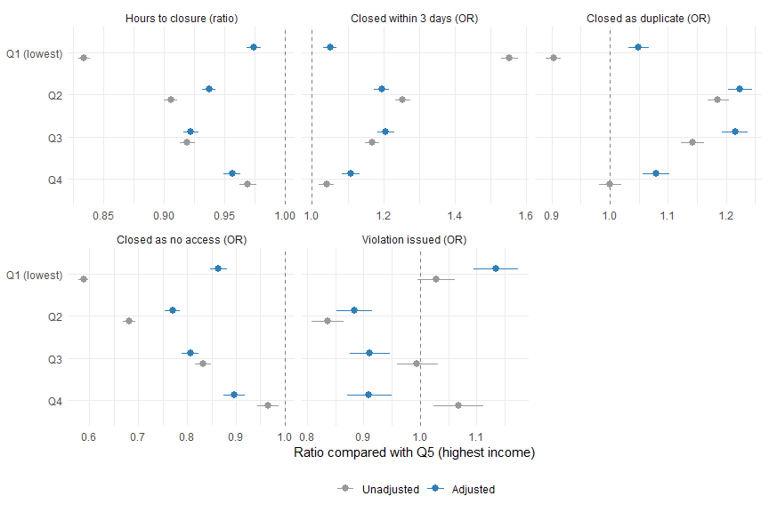
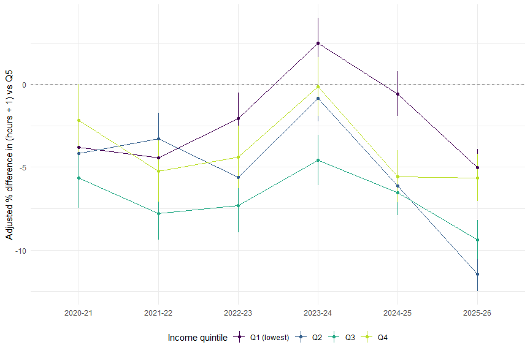

RQ3 Part 2: Regression Models for Complaint Handling by Income
================

Part 1 (`rq3_analysis.Rmd`) showed that complaints from lower-income
ZCTAs closed somewhat faster and were less often closed because HPD
could not gain access. It also showed that buildings differ across
income groups: complaints in higher-income ZCTAs come from smaller
buildings, and small buildings have much higher no-access rates. This
file asks whether the income differences remain after accounting for
building size and other complaint characteristics.

All models compare each income quintile with the highest-income quintile
(Q5). They describe associations, not causal effects.

This file fits ten models on about 1.4 million complaints, so knitting
takes a few minutes.

``` r
library(tidyverse)
library(broom)

knitr::opts_chunk$set(
  message = FALSE, warning = FALSE,
  fig.width = 9, fig.height = 6, out.width = "90%")

theme_set(theme_minimal() + theme(legend.position = "bottom"))

processed_dir = "data/processed"
```

## Model data

The models use closed complaints with an income group and a matched
residential building (at least one residential unit in PLUTO). Only the
columns used in the models are kept, to save memory.

``` r
model_df =
  read_rds(file.path(processed_dir, "rq3_analysis.rds")) |>
  filter(
    flag %in% c("ok", "zero", "over 1 year"),
    !is.na(income_q),
    !is.na(size)) |>
  transmute(
    season,
    month,
    income_q  = fct_relevel(income_q, "Q5 (highest)"),
    descriptor = factor(descriptor),
    problem   = factor(problem),
    borough   = factor(borough),
    channel   = factor(open_data_channel_type),
    log_units = log(unitsres),
    log_hours = log(hours + 1),
    closed_3d,
    duplicate = as.integer(res_cat == "duplicate"),
    no_access = as.integer(res_cat == "no_access"),
    violation = as.integer(res_cat == "violation"))

nrow(model_df)
```

    ## [1] 1439549

``` r
model_df |>
  count(income_q) |>
  knitr::kable(format.args = list(big.mark = ","))
```

| income_q     |       n |
|:-------------|--------:|
| Q5 (highest) |  96,245 |
| Q1 (lowest)  | 654,597 |
| Q2           | 395,015 |
| Q3           | 195,117 |
| Q4           |  98,575 |

## Outcomes and models

| Outcome | Model | Reported as |
|----|----|----|
| `log(hours + 1)` | `lm()` | ratio of (hours + 1) vs Q5; 1.10 means about 10% longer |
| Closed within 3 days | `glm(family = binomial())` | odds ratio vs Q5 |
| Closed as duplicate | `glm(family = binomial())` | odds ratio vs Q5 |
| Closed as no access | `glm(family = binomial())` | odds ratio vs Q5 |
| Violation issued | `glm(family = binomial())` | odds ratio vs Q5 |

Each outcome is fit twice: with income quintile only (unadjusted), and
with these controls added (adjusted):

- `season`, `month`: complaint volume and weather change over time
- `descriptor`: whole-building versus single-apartment complaints
- `problem`: no heat, no hot water, or both
- `borough`: HPD borough offices may differ
- `channel`: phone, online, or mobile app
- `log_units`: building size (log of residential units)

Confidence intervals are Wald intervals (estimate ± 1.96 standard
errors). Complaints from the same building are not independent, so these
intervals are too narrow; with more than a million complaints almost
every difference is “significant”, and the size of the ratios matters
more than the p-values.

``` r
controls = "season + month + descriptor + problem + borough + channel + log_units"

# Fit one model and keep only the income coefficients, so the large
# model object is not kept in memory
fit_income = function(outcome, adjusted, family) {

  rhs = if (adjusted) str_c("income_q + ", controls) else "income_q"
  model_formula = as.formula(str_c(outcome, " ~ ", rhs))

  fit =
    if (family == "linear") {
      lm(model_formula, data = model_df)
    } else {
      glm(model_formula, family = binomial(), data = model_df)
    }

  tidy(fit) |>
    filter(str_detect(term, "^income_q")) |>
    mutate(
      income_q = str_remove(term, "^income_q"),
      ratio = exp(estimate),
      low   = exp(estimate - 1.96 * std.error),
      high  = exp(estimate + 1.96 * std.error))
}

model_grid =
  tribble(
    ~outcome,    ~label,                          ~family,
    "log_hours", "Hours to closure (ratio)",      "linear",
    "closed_3d", "Closed within 3 days (OR)",     "logistic",
    "duplicate", "Closed as duplicate (OR)",      "logistic",
    "no_access", "Closed as no access (OR)",      "logistic",
    "violation", "Violation issued (OR)",         "logistic") |>
  expand_grid(adjusted = c(FALSE, TRUE))

model_results =
  model_grid |>
  mutate(estimates = pmap(list(outcome, adjusted, family), fit_income)) |>
  unnest(estimates) |>
  mutate(
    model = if_else(adjusted, "Adjusted", "Unadjusted"),
    income_q = factor(income_q, levels = c("Q1 (lowest)", "Q2", "Q3", "Q4")),
    label = fct_inorder(label))

write_csv(
  select(model_results, outcome, label, model, income_q, estimate, std.error, ratio, low, high),
  file.path(processed_dir, "rq3_model_results.csv"))
```

## Results

Each cell shows the ratio (95% CI) for that income quintile compared
with Q5. Values below 1 mean less than Q5; values above 1 mean more.

``` r
model_results |>
  mutate(est = sprintf("%.2f (%.2f, %.2f)", ratio, low, high)) |>
  select(label, income_q, model, est) |>
  pivot_wider(names_from = model, values_from = est) |>
  select(label, income_q, Unadjusted, Adjusted) |>
  knitr::kable()
```

| label                     | income_q    | Unadjusted        | Adjusted          |
|:--------------------------|:------------|:------------------|:------------------|
| Hours to closure (ratio)  | Q1 (lowest) | 0.83 (0.83, 0.84) | 0.97 (0.97, 0.98) |
| Hours to closure (ratio)  | Q2          | 0.91 (0.90, 0.91) | 0.94 (0.93, 0.94) |
| Hours to closure (ratio)  | Q3          | 0.92 (0.91, 0.93) | 0.92 (0.92, 0.93) |
| Hours to closure (ratio)  | Q4          | 0.97 (0.96, 0.98) | 0.96 (0.95, 0.96) |
| Closed within 3 days (OR) | Q1 (lowest) | 1.55 (1.53, 1.58) | 1.05 (1.03, 1.07) |
| Closed within 3 days (OR) | Q2          | 1.25 (1.23, 1.27) | 1.19 (1.17, 1.22) |
| Closed within 3 days (OR) | Q3          | 1.17 (1.15, 1.19) | 1.21 (1.18, 1.23) |
| Closed within 3 days (OR) | Q4          | 1.04 (1.02, 1.06) | 1.11 (1.08, 1.13) |
| Closed as duplicate (OR)  | Q1 (lowest) | 0.90 (0.89, 0.92) | 1.05 (1.03, 1.07) |
| Closed as duplicate (OR)  | Q2          | 1.19 (1.17, 1.20) | 1.22 (1.20, 1.24) |
| Closed as duplicate (OR)  | Q3          | 1.14 (1.12, 1.16) | 1.22 (1.19, 1.24) |
| Closed as duplicate (OR)  | Q4          | 1.00 (0.98, 1.02) | 1.08 (1.06, 1.10) |
| Closed as no access (OR)  | Q1 (lowest) | 0.59 (0.58, 0.60) | 0.86 (0.85, 0.88) |
| Closed as no access (OR)  | Q2          | 0.68 (0.67, 0.69) | 0.77 (0.75, 0.79) |
| Closed as no access (OR)  | Q3          | 0.83 (0.82, 0.85) | 0.81 (0.79, 0.82) |
| Closed as no access (OR)  | Q4          | 0.97 (0.94, 0.99) | 0.90 (0.87, 0.92) |
| Violation issued (OR)     | Q1 (lowest) | 1.03 (1.00, 1.06) | 1.13 (1.09, 1.17) |
| Violation issued (OR)     | Q2          | 0.84 (0.81, 0.86) | 0.88 (0.85, 0.92) |
| Violation issued (OR)     | Q3          | 0.99 (0.96, 1.03) | 0.91 (0.88, 0.95) |
| Violation issued (OR)     | Q4          | 1.07 (1.02, 1.11) | 0.91 (0.87, 0.95) |

``` r
model_results |>
  mutate(model = fct_relevel(model, "Unadjusted")) |>
  ggplot(aes(x = ratio, y = fct_rev(income_q), color = model)) +
  geom_vline(xintercept = 1, linetype = "dashed", color = "grey50") +
  geom_pointrange(
    aes(xmin = low, xmax = high),
    position = position_dodge(width = 0.5)) +
  facet_wrap(~ label, scales = "free_x") +
  scale_color_manual(values = c(Unadjusted = "grey60", Adjusted = "#2c7fb8")) +
  labs(
    x = "Ratio compared with Q5 (highest income)",
    y = NULL,
    color = NULL)
```



How much did adjustment change the Q1 versus Q5 comparison?

``` r
model_results |>
  filter(income_q == "Q1 (lowest)") |>
  select(label, model, ratio) |>
  pivot_wider(names_from = model, values_from = ratio) |>
  mutate(
    gap_unadjusted = Unadjusted - 1,
    gap_adjusted = Adjusted - 1,
    share_of_gap_remaining = gap_adjusted / gap_unadjusted) |>
  knitr::kable(digits = 3)
```

| label | Unadjusted | Adjusted | gap_unadjusted | gap_adjusted | share_of_gap_remaining |
|:---|---:|---:|---:|---:|---:|
| Hours to closure (ratio) | 0.834 | 0.974 | -0.166 | -0.026 | 0.154 |
| Closed within 3 days (OR) | 1.553 | 1.051 | 0.553 | 0.051 | 0.092 |
| Closed as duplicate (OR) | 0.903 | 1.049 | -0.097 | 0.049 | -0.505 |
| Closed as no access (OR) | 0.587 | 0.864 | -0.413 | -0.136 | 0.329 |
| Violation issued (OR) | 1.028 | 1.134 | 0.028 | 0.134 | 4.812 |

## Did the closure-time gap change by season?

The adjusted closure-time model is refit separately for each heating
season (same controls except season). If lower-income complaints were
handled worse when volume spiked, the Q1 estimate for 2025-26 would rise
above the earlier seasons.

``` r
season_controls = "month + descriptor + problem + borough + channel + log_units"

season_results =
  model_df |>
  nest(data = -season) |>
  mutate(
    estimates = map(data, \(d) {
      lm(as.formula(str_c("log_hours ~ income_q + ", season_controls)), data = d) |>
        tidy() |>
        filter(str_detect(term, "^income_q"))
    })) |>
  select(-data) |>
  unnest(estimates) |>
  mutate(
    income_q = factor(str_remove(term, "^income_q"),
                      levels = c("Q1 (lowest)", "Q2", "Q3", "Q4")),
    pct_diff = (exp(estimate) - 1) * 100,
    low  = (exp(estimate - 1.96 * std.error) - 1) * 100,
    high = (exp(estimate + 1.96 * std.error) - 1) * 100) |>
  arrange(season, income_q)

season_results |>
  ggplot(aes(x = season, y = pct_diff, color = income_q, group = income_q)) +
  geom_hline(yintercept = 0, linetype = "dashed", color = "grey50") +
  geom_line() +
  geom_pointrange(aes(ymin = low, ymax = high), size = 0.3) +
  scale_color_viridis_d(end = 0.9) +
  labs(
    x = NULL,
    y = "Adjusted % difference in (hours + 1) vs Q5",
    color = "Income quintile")
```



## Sensitivity check: excluding the last two seasons

Part 1 showed that open complaints are rare before 2024-25 but reach
4.3% of Q1 complaints in 2025-26, against 2-3% in other quintiles.
Because open complaints have no closure time, the main models could make
Q1 look faster than it was. Refitting the adjusted closure-time model on
2020-21 to 2023-24, when almost every complaint was closed, checks this.

``` r
lm(as.formula(str_c("log_hours ~ income_q + ", controls)),
   data = filter(model_df, season %in% c("2020-21", "2021-22", "2022-23", "2023-24"))) |>
  tidy() |>
  filter(str_detect(term, "^income_q")) |>
  mutate(
    income_q = str_remove(term, "^income_q"),
    ratio = exp(estimate),
    low   = exp(estimate - 1.96 * std.error),
    high  = exp(estimate + 1.96 * std.error)) |>
  select(income_q, ratio, low, high) |>
  knitr::kable(digits = 3)
```

| income_q    | ratio |   low |  high |
|:------------|------:|------:|------:|
| Q1 (lowest) | 0.985 | 0.977 | 0.993 |
| Q2          | 0.968 | 0.960 | 0.976 |
| Q3          | 0.937 | 0.929 | 0.945 |
| Q4          | 0.973 | 0.963 | 0.982 |

## Notes for interpretation

- A ratio below 1 for closure time means faster closure than Q5, not
  better service: a complaint can close quickly as a duplicate or after
  a phone call without an inspection.
- Building size (`log_units`) is the most important control for
  no-access and duplicate closures, because small buildings are harder
  to enter and large buildings generate many duplicate complaints.
- Income is measured for the ZCTA, not for the person who complained.
- Standard errors ignore clustering of complaints within buildings, so
  the confidence intervals are too narrow.
